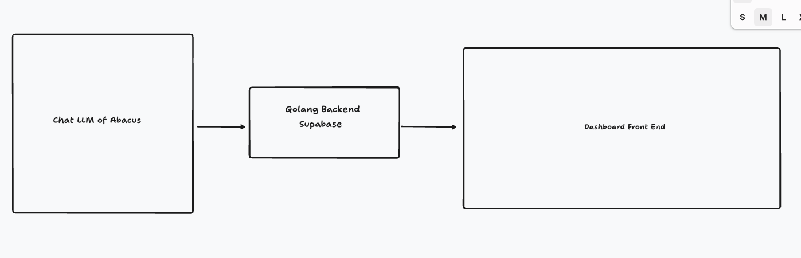

# Chronos Agent

## What is it?

Chronos Agent is an agent designed to help with personal finances on a day-to-day basis — tracking fixed monthly bills, logging simple expenses (like buying an ice cream or grabbing lunch), and keeping a clear record of where every cent goes.

It works in the simplest way possible: the user types a message in a chat interface, such as:

- *"I bought X today for Y amount"*
- *"I paid the water bill for this month"*
- *"Create a bill payment for day 15"*

The agent — connected to an Abacus LLM — interprets the intent and registers the transaction in a dashboard automatically.

## Why was it created?

The need was simple: organize personal finances, track monthly expenses, and have a real sense of where money is going. Instead of manually filling spreadsheets or navigating complex finance apps, the idea was to have a conversational agent to handle these tasks naturally.

The name **Chronos** comes from the Greek god of time — a reference to the time the user saves by delegating these small but recurring financial tasks to an agent.

## How it works

The project is composed of three layers:

- **Chat (Abacus LLM)** — receives the user's message in natural language and classifies the intent into a structured action (`pay`, `create_expense`, `create_recurring`, `query`).
- **Go Backend + Supabase** — processes the action, executes the appropriate database operation, and manages all business logic (recurring bill generation, transaction lifecycle, authentication).
- **Vite.js Frontend (Dashboard)** — displays all transactions and allows the user to review, edit, or manage entries directly.

## Interacting with the project

The primary interaction is through the chat interface, where the agent handles transaction creation on the user's behalf. However, the dashboard is always available for manual review or edits — the project is not limited to the chat alone.

> **Language note:** For this initial version (MVP), the agent communicates in Brazilian Portuguese (PT-BR). English support is planned for future versions.

## Scope

This is a personal project, built for a single user's own financial management. It is not intended to be a multi-tenant or publicly hosted service.
